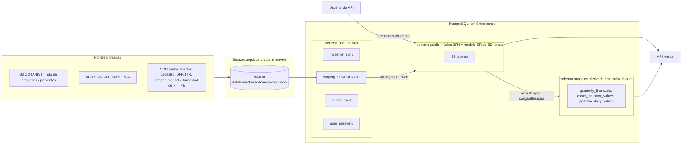
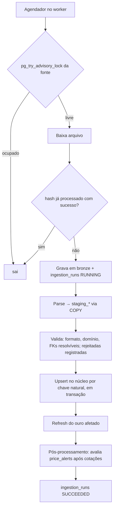
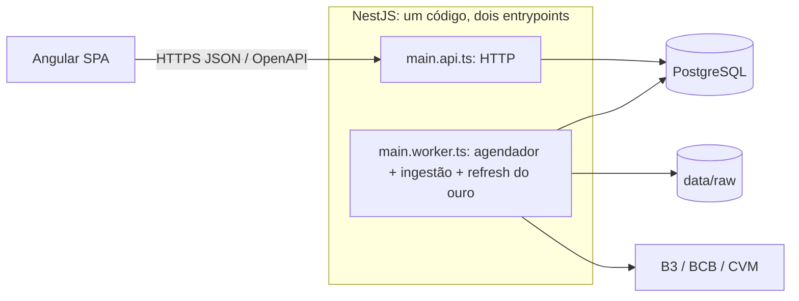

# Arquitetura — Carteira B3 (dados e aplicação)

> **Status: APROVADA em 30/09/2026.** As decisões da seção 11 estão registradas como D20–D28 em `claude/contexto-projeto.md`, junto com D29 (eventos corporativos no S2), D30 (CPF), D31 (FII trimestral, revista em 05/10), D32 (normalização 3FN e IR versionado) e D33 (testes em `.spec.ts`). Este documento é obrigatório para os agentes de banco, backend, frontend e UX/UI.
> Autor: agente de banco de dados. Base: `claude/contexto-projeto.md` (escopo de 30/09/2026) e `claude/enunciadoBancoDeDados.md`.
> Os prompts em `agentes/` foram reescritos em 05/10/2026 a partir deste documento; em conflito, vale este documento.
> Modelo ER detalhado (entidades, relacionamentos, cardinalidades): `database/docs/modelo-er.md`.

---

## 1. Inventário dos dados

A arquitetura parte do comportamento dos dados. O projeto tem **três naturezas de dado** com ciclos de vida diferentes. Uma arquitetura única para as três é o erro a evitar.

| Natureza | Exemplos | Origem | Escrita | Mutabilidade | Volume estimado (premissas) |
|---|---|---|---|---|---|
| **1. Dado do usuário (transacional)** | usuários, carteiras, operações, importações, proventos recebidos, favoritos, alertas, rankings salvos, apurações e DARF | Usuário via API | Contínua, baixa taxa, exige integridade e transação | Editável (RN10), exceto apurações de IR fechadas (D10) | Pequeno: centenas a milhares de linhas por usuário |
| **2. Dado externo de referência/mercado** | ativos, emissores, setores, cotações, índices (CDI, Selic, IPCA, Ibovespa), demonstrações CVM, informes mensais de FII, informes trimestrais de FII com os imóveis declarados, comunicados, proventos e eventos | B3, BCB, CVM (fonte primária) | Em lote, agendada, idempotente | Só a ingestão escreve; reprocessável a partir do arquivo bruto | Cotações: 1.500–3.000 tickers × ~250 pregões × 10 anos ≈ **4–7,5 M linhas**. Linhas de demonstração: ~400 empresas × 4 entregas/ano × 150–300 contas × 10 anos ≈ **2,5–5 M linhas**. Itens de imóveis dos informes trimestrais: ~20 mil por ano (medido em 2025) × 10 anos ≈ 200 mil. Demais: < 100 mil |
| **3. Dado derivado** | posição, PM, lucro realizado, valor de mercado, alocação, TWR, evolução patrimonial, indicadores fundamentalistas, vacância do fundo, VP por cota, base e imposto do IR, valor e vencimento do DARF, rankings, Graham, Bazin, checklist, DY, payout | Calculado a partir de 1 e 2 | Nunca pelo usuário | Recalculável a qualquer momento (D4, D17) | Indicadores: ~1.000 ativos × ~25 indicadores × ~40 trimestres ≈ 1 M linhas |

Conclusões:
- O volume total (≤ ~15 M linhas, poucos GB) cabe folgadamente em um PostgreSQL com índices B-tree comuns. **Não há justificativa de volume** para data warehouse, particionamento ou motor analítico separado.
- O desafio é **integridade, proveniência e recálculo**, não escala.

## 2. Avaliação dos modelos de arquitetura

| Modelo | O que é | Encaixe no projeto | Veredito |
|---|---|---|---|
| **Snowflake** (sugerido) | Modelo dimensional de DW: tabelas-fato cercadas por dimensões normalizadas em hierarquia | É um modelo **OLAP**, feito para leitura analítica de fatos imutáveis. O núcleo do sistema é **OLTP**: edição retroativa (RN10), unicidade, transações. Exigiria um ETL do OLTP para o DW, uma dimensão de data artificial e chaves substitutas com histórico (SCD). No ER da disciplina, isso aparece como entidades técnicas que não representam o domínio, que é justamente o critério de avaliação. A única parte do snowflake que serve (a hierarquia ativo → emissor → setor normalizada) **já sai naturalmente da 3FN**. | **Rejeitado** como modelo principal |
| **Medalhão** (bronze/prata/ouro) | Padrão de lakehouse para pipelines de ingestão: bruto → limpo → agregado | Serve bem à **natureza 2** (arquivos da B3, BCB e CVM, que precisam de reprocessamento e rastreabilidade) e à **natureza 3** (ouro = derivado recalculável). **Não** serve à natureza 1: o dado do usuário nasce já validado na API e não tem "bruto". Implantá-lo inteiro (Spark, Delta, data lake) seria desproporcional. | **Adotado em versão leve**, só para dado externo e derivado |
| Event sourcing | Estado reconstruído de um log de eventos imutáveis | A RN10 exige editar e excluir operações. O benefício (histórico reconstruível) já vem do D4. | Rejeitado |
| Documentos/NoSQL | JSON por agregado | Não tem DDL relacional nem JOINs (exigências de BD), e o domínio é fortemente relacional | Rejeitado |
| **Relacional normalizado (3FN, OLTP)** | Modelo ER → relacional clássico | Integridade no banco, casa 1:1 com os entregáveis de BD, atende as naturezas 1 e 2 | **Adotado como núcleo** |

**Decisão: arquitetura híbrida.** Núcleo relacional em 3FN, que é o modelo ER da disciplina, com medalhão leve em volta: arquivos brutos como bronze, o núcleo normalizado como prata e caches derivados recalculáveis como ouro.

## 3. Arquitetura de dados



### 3.1 Zonas

| Zona | Onde | Conteúdo | Regras |
|---|---|---|---|
| **Bronze** | Volume em disco (`data/raw/`), fora do banco | Arquivos exatamente como baixados (ZIP, CSV, TXT) | Imutável. Nome com fonte, data de referência e hash SHA-256. Todo dado externo do banco pode ser reconstruído a partir daqui. |
| **ops** | Schema `ops` | `ingestion_runs` (fonte, arquivo, hash, data de referência, status, linhas lidas/gravadas/rejeitadas, erro), tabelas `staging_*` UNLOGGED, `import_rows` (linhas da planilha B3 antes da confirmação), `user_sessions` (refresh tokens com hash) | Técnico. **Fora do ER.** Staging é truncável. |
| **Prata (núcleo)** | Schema `public` | As entidades do domínio (seção 4) | **Tudo em `public` está no ER, e nada fora de `public` está no ER.** Integridade por FK, CHECK e UNIQUE. É a fonte da verdade. |
| **Ouro** | Schema `analytics` | Tabelas de cache e materialized views derivadas | Pode ser apagado e reconstruído a qualquer momento (D17). Nunca é fonte da verdade. **Fora do ER.** Só o worker escreve. |

### 3.2 Esclarecimento do D7
"Um único schema" passa a significar **um único banco e um único `schema.prisma`**, dividido em três schemas PostgreSQL. O `database/sql/ddl.sql` de BD passa a ser gerado por `pg_dump --schema-only --schema=public` a partir do banco migrado. Continua sendo gerado, nunca escrito à mão, e fica restrito ao que está no ER. Os objetos de `ops` e `analytics` são criados por SQL nas migrations do Prisma (recurso `multiSchema`, estável no Prisma 7 sem preview feature; primeira migration em `ops` no D2, D39).

## 4. Núcleo relacional (schema `public`)

São 29 tabelas: 27 entidades e 2 relacionamentos N:N com atributos (`watchlist_items`, `screen_criteria`). Todas na 3FN (verificação em `database/docs/modelo-er.md`, seção 6). O detalhamento conceitual (nomes em português, relacionamentos nomeados e cardinalidades) está em `database/docs/modelo-er.md`.

**Padrões:**
- PK `uuid` gerada no banco para entidades com identidade própria.
- **PK composta natural** para séries temporais (entidades fracas) e associativas (volume alto; a chave natural já é única e é o caminho de acesso). Ver D23.
- Datas de registro do ER (`created_at`, `added_at`…) em `timestamptz`; sem `updated_at` nas tabelas de `public` (D34).
- Monetário em `NUMERIC(18,2)`; unitário ou por ação em `NUMERIC(20,8)`; percentuais e alíquotas como fração de 0 a 1 em `NUMERIC(10,8)`; proibido `float`.
- Nomes em inglês, `snake_case`, plural. Enums como tipos PostgreSQL. Nenhuma coluna com nome de palavra reservada (ex.: `indicator_group`, não `group`).

| # | Tabela | Atributos principais | Relacionamentos | Restrições / chave |
|---|---|---|---|---|
| **Conta e carteira** |||||
| 1 | `users` | name, email, password_hash | — | email `citext` UNIQUE. **Sem CPF** (D30) |
| 2 | `brokers` | name, cnpj | — | cnpj UNIQUE |
| 3 | `portfolios` | name | N:1 users (CASCADE) | UNIQUE (user_id, name) |
| 4 | `import_batches` | file_name, file_sha256, status {PENDING, CONFIRMED, DISCARDED}, row_count, confirmed_at | N:1 portfolios (CASCADE) | UNIQUE (portfolio_id, file_sha256): impede importar o mesmo arquivo duas vezes |
| 5 | `operations` | type {BUY, SELL}, trade_date, quantity int, unit_price, fees, sequence bigserial | N:1 portfolios (CASCADE), N:1 assets (RESTRICT), N:1 brokers (RESTRICT), N:1 import_batches (nulo = lançamento manual) | CHECK quantity > 0, unit_price > 0, fees ≥ 0; índice (portfolio_id, asset_id, trade_date, sequence) |
| **Catálogo** |||||
| 6 | `sectors` | name | autorrelacionamento N:1 sectors (pai) | UNIQUE (parent_id, name); profundidade máxima 3. Classificação setorial da B3; o nível (setor → subsetor → segmento) é a profundidade e não é coluna (D32) |
| 7 | `issuers` | name, kind {COMPANY, FUND, FOREIGN}, cnpj, cvm_code | N:1 sectors (segmento, nulo permitido) | cnpj UNIQUE quando não nulo; cvm_code UNIQUE quando não nulo. É a ponte entre CVM (cnpj/cvm_code) e B3 (ticker) |
| 8 | `assets` | ticker, isin, type {STOCK, FII, ETF, BDR}, share_class {ON, PN, PNA, PNB, UNIT} (nulo fora de ações), is_active | N:1 issuers | ticker UNIQUE + CHECK de formato; isin UNIQUE. O ISIN protege contra troca de ticker na ingestão do COTAHIST |
| **Mercado** |||||
| 9 | `quotes` | quote_date, open, high, low, close, volume, trades_count | N:1 assets | **PK (asset_id, quote_date)**; CHECK preços > 0, low ≤ high. Preço **não ajustado**, como publicado pela B3 |
| 10 | `economic_indexes` | code {CDI, SELIC, IPCA, IBOV}, name, periodicity {DAILY, MONTHLY}, unit {RATE_PERCENT, POINTS}, source | — | code UNIQUE |
| 11 | `index_values` | reference_date, value NUMERIC(20,8) | N:1 economic_indexes | **PK (economic_index_id, reference_date)** |
| **Fundamentos** |||||
| 12 | `financial_statements` | filing_type {DFP, ITR}, fiscal_year_start, period_end, version, filed_at, common_shares, preferred_shares, treasury_common, treasury_preferred | N:1 issuers | UNIQUE (issuer_id, period_end). É o documento entregue à CVM, com os dois escopos; guarda a última versão (D27). A quantidade de ações vem da composição do capital |
| 13 | `statement_lines` | scope {INDIVIDUAL, CONSOLIDATED}, account_code, account_description, value NUMERIC(18,2) | N:1 financial_statements (CASCADE) | **PK (financial_statement_id, scope, account_code)**. O demonstrativo é o 1º dígito do código (1 BPA, 2 BPP, 3 DRE, 4 DRA, 6 DFC, 7 DVA; DMPL não é carregada). `value` é o valor do período do documento como publicado (BP: saldo; DRE/DRA no ITR: trimestre; DFC/DVA no ITR: acumulado). Valores em R$ unitários (escala MIL normalizada na ingestão) |
| 14 | `fii_monthly_reports` | reference_month, version, net_worth, shares_outstanding, shareholders_count, dividend_yield_month | N:1 issuers (kind FUND) | UNIQUE (issuer_id, reference_month). Fonte: informe mensal da CVM (`Patrimonio_Liquido`, `Cotas_Emitidas`, `Total_Numero_Cotistas`, `Percentual_Dividend_Yield_Mes`). VP por cota é derivado (D32) |
| 15 | `fii_quarterly_reports` | reference_date, version | N:1 issuers (kind FUND) | UNIQUE (issuer_id, reference_date); última versão (D27). Fonte: informe trimestral estruturado da CVM (D31) |
| 16 | `fii_report_properties` | item_number, name, address, property_class {RENT_FINISHED, RENT_UNDER_CONSTRUCTION, SALE_FINISHED, SALE_UNDER_CONSTRUCTION}, area, vacancy_rate, delinquency_rate, revenue_share, leased_rate | N:1 fii_quarterly_reports (CASCADE) | **PK (fii_quarterly_report_id, item_number)**; item_number = ordem no arquivo. CHECK taxas entre 0 e 1; vacancy_rate só em RENT_FINISHED; leased_rate só em RENT_UNDER_CONSTRUCTION. Fonte: `inf_trimestral_fii_imovel`; cada linha é um item declarado (laje, unidade ou imóvel), sem identidade estável entre trimestres (D31) |
| 17 | `corporate_filings` | category, subject, reference_date, delivered_at, document_url, cvm_protocol | N:1 issuers | cvm_protocol UNIQUE |
| **Proventos e eventos** |||||
| 18 | `corporate_events` | type {SPLIT, REVERSE_SPLIT, BONUS}, ex_date, ratio_from, ratio_to, bonus_unit_cost, source {B3, MANUAL} | N:1 assets | CHECK ratio_from > 0, ratio_to > 0; bonus_unit_cost obrigatório só em BONUS; UNIQUE (asset_id, type, ex_date). Registro manual já no S2 (D29) |
| 19 | `income_distributions` | type {DIVIDEND, JCP, FII_INCOME}, record_date (data-com), payment_date (nulo = a definir), amount_per_share, source | N:1 assets | CHECK amount_per_share > 0; payment_date ≥ record_date quando não nulo |
| 20 | `received_income` | base_quantity, gross_amount, withheld_tax, received_at | N:1 portfolios, N:1 income_distributions, N:1 brokers | UNIQUE (portfolio_id, income_distribution_id, broker_id); CHECK withheld_tax ≥ 0. Fato informado (D11) |
| **IR** |||||
| 21 | `tax_categories` | code {COMMON_STOCK, COMMON_OTHER, DAY_TRADE, FII} (D35), name, revenue_code | — | code UNIQUE. Seed; código de receita 6015 em todas (validado no P0, `database/docs/memoria-calculo.md`) |
| 22 | `tax_rules` | effective_from, rate, sales_exemption_limit | N:1 tax_categories | **PK (tax_category_id, effective_from)**; CHECK 0 ≤ rate ≤ 1. Regra vigente de uma apuração = maior effective_from ≤ mês (consulta, não FK) (D32) |
| 23 | `tax_assessments` | reference_month, total_sales, net_result, loss_offset, closed_at | N:1 users; N:1 tax_categories; N:1 darfs (nulo até gerar a guia) | UNIQUE (user_id, reference_month, tax_category_id). Guarda só os insumos fechados do mês; base e imposto são derivados da regra vigente (D10 revista, D32) |
| 24 | `darfs` | reference_month, amount_paid, paid_at | N:1 users; 1:N tax_assessments | UNIQUE (user_id, reference_month), validado no P0: um DARF 6015 por mês reúne todas as categorias. Valor devido (soma das apurações quitadas) e vencimento são derivados; amount_paid e paid_at são fatos informados pelo usuário |
| **Referência analítica** |||||
| 25 | `indicators` | code (PL, PVP, EV_EBITDA, DY, ROE, ROIC, NET_MARGIN, VACANCY…), name, indicator_group {VALUATION, EFFICIENCY, PROFITABILITY, DEBT, GROWTH, FII}, formula, unit {RATIO, PERCENT, CURRENCY}, applies_to {STOCK, FII} | — | code UNIQUE. Catálogo que alimenta o "como foi calculado" (D12), os filtros do ranking e o cache do ouro |
| **Usuário** |||||
| 26 | `watchlist_items` | added_at | N:1 users, N:1 assets (associativa N:N) | **PK (user_id, asset_id)** |
| 27 | `price_alerts` | target_price, direction {ABOVE, BELOW}, triggered_at, triggered_quote_date | N:1 users, N:1 assets | CHECK target_price > 0 |
| 28 | `saved_screens` | name, asset_type {STOCK, FII}, sort_direction | N:1 users; N:1 indicators (ordenação) | UNIQUE (user_id, name) |
| 29 | `screen_criteria` | min_value, max_value | N:1 saved_screens (CASCADE), N:1 indicators (associativa N:N com atributos) | **PK (saved_screen_id, indicator_id)**; CHECK min ≤ max e pelo menos um não nulo. Substitui um JSON de filtros, mantendo a 1FN |

**O que não é armazenado no núcleo** (derivado, D4, D17, D31 e D32): posição, PM, lucro realizado, valor de mercado, alocação, rentabilidade, indicadores, vacância do fundo, VP por cota, nível do setor, base de cálculo e imposto do IR, valor devido e vencimento do DARF, preço justo, preço-teto, checklist, DY e payout. As calculadoras (H1–H4) não usam banco.

## 5. Camada ouro (schema `analytics`)

| Objeto | Derivado de | Consumido por | Atualização |
|---|---|---|---|
| `quarterly_financials` | `statement_lines` via mapeamento de contas padrão (código) | Indicadores, C5, C6 | Após carga DFP/ITR do emissor. Calcula o acumulado e o trimestre isolado de cada conta (4º tri = DFP − 9 meses; trimestre de DFC/DVA = diferença entre acumulados) e os últimos 12 meses (TTM) |
| `asset_indicator_values` (asset, indicator, reference_date, value, inputs jsonb) | `quarterly_financials` + `quotes` + `financial_statements` (ações) + `fii_monthly_reports` e `fii_report_properties` (FIIs) + `corporate_events` (ajuste da quantidade de ações após evento) | C4, C5, C8, C10, D1–D4 | Após carga de cotações (valor atual), de demonstrações e informes (histórico) e de registro de evento. `inputs` guarda os insumos para o "como foi calculado". A vacância do fundo (`VACANCY`) é a média de `vacancy_rate` ponderada por `area` nos itens RENT_FINISHED da última versão do informe trimestral; FII sem esses itens não tem o indicador. VP por cota (`NAV_PER_SHARE`) = net_worth / shares_outstanding |
| `portfolio_daily_values` (portfolio, date, market_value, invested, net_flow) | operations + quotes + corporate_events (+ proventos no S6) | B10, B11 | Invalidação a partir da data da operação ou do evento alterado, com recálculo em segundo plano (S9) |

A posição atual **não** vai para o ouro: é calculada sob demanda a partir das operações da carteira e dos eventos corporativos do ativo. São centenas de linhas por carteira, abaixo de 10 ms (RN09).

## 6. Fluxos de dados

### 6.1 Comando do usuário (ex.: lançar ou editar operação)
```mermaid
sequenceDiagram
  participant F as Frontend
  participant C as Controller (DTO + ValidationPipe)
  participant U as Caso de uso
  participant R as Repositório (Prisma)
  participant D as PositionCalculator (domínio puro)
  F->>C: POST /portfolios/:id/operations
  C->>U: comando validado (Decimal)
  U->>R: BEGIN; lock (portfolio, asset); carrega linha do tempo (operações + eventos)
  U->>D: recalcula linha do tempo com a alteração
  alt posição negativa em algum ponto
    D-->>U: erro de domínio (operação, data, disponível vs. vendido)
    U-->>C: rollback → 422 problem+json
  else válido
    U->>R: grava operação; COMMIT
    U-->>F: 201 + posição recalculada (DerivedValue com trace)
  end
```

### 6.2 Importação da planilha B3 (B12)
1. Upload → `import_batches` (PENDING) + linhas interpretadas em `ops.import_rows`, com erro por linha.
2. O frontend mostra a pré-visualização (linhas válidas, rejeitadas e dados faltantes, como custos e corretora).
3. Confirmação → todas as operações entram em **uma** transação com recálculo (mesma regra da 6.1). Qualquer violação rejeita o lote inteiro e aponta a linha.
4. `import_batches` → CONFIRMED; `ops.import_rows` é descartado.

### 6.3 Ingestão externa (medalhão leve)

Propriedades obrigatórias:
- **Idempotente:** reprocessar o mesmo arquivo não muda nada (hash + `ON CONFLICT DO UPDATE` por chave natural).
- **Reconstruível:** o núcleo externo pode ser apagado e recarregado a partir do bronze.
- **Rastreável:** cada dado externo exibido informa fonte e data de referência.

| Fonte | Tabelas alimentadas | Frequência | Chave natural do upsert |
|---|---|---|---|
| B3 lista de empresas / classificação setorial | sectors, issuers, assets | Semanal | sector (parent, name); issuer cnpj; asset ticker/isin |
| CVM cadastro de companhias | issuers (cvm_code, situação) | Semanal | cnpj |
| B3 COTAHIST (diário + anual para carga inicial) | quotes | Diária, após publicação (horário a confirmar) | (asset_id, quote_date) |
| BCB SGS | index_values (CDI, Selic, IPCA) | Diária / mensal | (index, date) |
| Ibovespa | index_values (IBOV) | Diária | (index, date); fonte a confirmar (R3) |
| CVM DFP/ITR | financial_statements, statement_lines | Semanal (reprocessa o ano corrente) | documento: (issuer, period_end); linha: (documento, scope, account_code) |
| CVM informe mensal FII | fii_monthly_reports | Mensal | (issuer, month) |
| CVM informe trimestral estruturado FII (`inf_trimestral_fii_imovel`) | fii_quarterly_reports, fii_report_properties | Semanal (a CVM atualiza com reapresentações) | informe: (issuer cnpj, reference_date); itens: substituídos em bloco quando chega versão maior (item_number = ordem no arquivo). Área e taxas chegam como texto e são normalizadas |
| CVM IPE | corporate_filings | Diária | cvm_protocol |
| Proventos e eventos | income_distributions, corporate_events | A definir (R2). Até lá, eventos corporativos por registro manual (D29) | (asset, type, date) |

### 6.4 Leitura (página do ativo, ranking, carteira)
- **Carteira:** caso de uso de consulta → operações + eventos corporativos → `PositionCalculator` → DTO.
- **Página do ativo, ranking, comparador:** *query services* com SQL direto sobre `public` + `analytics` (Prisma TypedSQL/`$queryRaw` tipado), sem passar por entidades de domínio (CQRS leve, seção 7.3).
- **Página do FII:** itens de imóveis do último informe trimestral (`fii_quarterly_reports` + `fii_report_properties`) e a vacância do fundo por trimestre, vinda de `asset_indicator_values` com o trace da média ponderada. Comparação de um mesmo imóvel entre trimestres é por nome, como aproximação, e a tela diz isso.
- **Ranking (D1):** `saved_screens` + `screen_criteria` viram um filtro SQL parametrizado sobre o valor mais recente de `asset_indicator_values`. Nunca é SQL montado por concatenação.

### 6.5 Fechamento de IR (S7)
Operações de **todas** as carteiras do usuário (D8) → classificação (comum / day trade por mesma data / FII por tipo de ativo) → apuração mensal com PM fiscal por usuário → o usuário fecha o mês → `tax_assessments` guarda os insumos fechados (D10) → base e imposto calculados com a `tax_rules` vigente no mês → `darfs`. O sistema calcula o DARF (valor devido, código de receita da categoria, vencimento) e registra o pagamento informado; a guia oficial é emitida pelo usuário no Sicalc da Receita, que pede o CPF (D30). Uma alteração retroativa em mês fechado **não** reescreve a apuração fechada: o sistema compara o recálculo com os insumos fechados, sinaliza a divergência e exige um fluxo explícito de retificação.

## 7. Arquitetura da aplicação

### 7.1 Estilo: monólito modular com dois processos

- **Por que não microsserviços:** 1–2 pessoas, um banco, sem requisito de escala independente. O custo operacional não se paga.
- **Por que dois processos:** o parse de arquivos da CVM e da B3 (dezenas a centenas de MB) bloqueia o event loop do Node e degradaria a API. Os dois processos compartilham os mesmos módulos e sobem como dois serviços no `docker-compose`.
- **Sem fila externa (Redis/BullMQ):** a coordenação usa `ops.ingestion_runs` + advisory locks do PostgreSQL. Uma fila é reavaliada só se houver mais de um worker.

### 7.2 Módulos (contextos) e camadas
Camadas por módulo (`domain` / `application` / `infrastructure` / `presentation`) e regra de dependência verificada por lint, como no prompt do backend.

| Módulo | Responsabilidade | Tabelas que **escreve** | Etapa |
|---|---|---|---|
| `shared` | Money/Decimal, Ticker, erros base, DerivedValue, paginação, problem+json | — | S1 |
| `auth` | Login, JWT de acesso curto + refresh rotativo em cookie httpOnly | ops.user_sessions | S1 |
| `users` | Cadastro | users | S1 |
| `reference-data` | Catálogo (setores, emissores, ativos, corretoras, indicadores); leitura pela API | sectors, issuers, assets, brokers, indicators (só via ingestão/seed) | S1 |
| `portfolios` | Carteiras e propriedade | portfolios | S1 |
| `operations` | Operações, `PositionCalculator`, posição, totais | operations | S1 |
| `imports` | Planilha B3 | import_batches, ops.import_rows, operations (via serviço de `operations`) | S9 |
| `market-data` | Cotações, índices, valor de mercado, alocação, rentabilidade do ativo | quotes, economic_indexes, index_values | S2 |
| `corporate-actions` | Eventos corporativos na linha do tempo do `PositionCalculator` | corporate_events | **S2: registro manual (D29)**; S6: fonte automática |
| `fundamentals` | Demonstrações, trimestres, indicadores, FIIs (informes mensal e trimestral), comunicados | financial_statements, statement_lines, fii_monthly_reports, fii_quarterly_reports, fii_report_properties, corporate_filings, analytics.* | S3, S8 |
| `screening` | Ranking, filtros salvos, comparador | saved_screens, screen_criteria | S4 |
| `valuation` | Graham, Bazin, checklist (funções puras) | — | S4 |
| `calculators` | H1–H4 (funções puras, sem banco) | — | S5 |
| `income` | Proventos e proventos recebidos, agenda | income_distributions, received_income | S6 |
| `tax` | Apuração, regras e DARF | tax_assessments, darfs; tax_categories e tax_rules só via seed | S7 |
| `watchlist` | Favoritos e alertas | watchlist_items, price_alerts | S10 |
| `ingestion` | Orquestração: agenda, locks, bronze, runs. Cada fonte é um adapter na `infrastructure` do módulo dono, implementando a porta `SourceIngestor` | ops.ingestion_runs, ops.staging_* | S2 |

Regras:
- **Cada tabela tem exatamente um módulo dono de escrita** (coluna acima). Outro módulo só lê via serviço exportado.
- O schema Prisma é do agente de banco. Nenhum módulo cria repositório para tabela de etapa ainda não iniciada.
- Registro manual de evento corporativo (D29): quem registra no S2 é o mantenedor, pelo seed ou por endpoint administrativo protegido. O evento vale para todos os usuários, porque é fato do ativo, não da carteira.

### 7.3 CQRS leve
- **Comandos** (escrita): controller → caso de uso → domínio → repositório, em transação.
- **Consultas** de leitura intensiva (página do ativo, ranking, histórico, séries para gráfico): *query services* na `infrastructure`, com SQL tipado e retorno direto em DTO de leitura.
- Não existe event store, barramento de eventos ou banco de leitura separado: o mesmo PostgreSQL atende os dois lados.

### 7.4 Contratos transversais da API
| Contrato | Regra |
|---|---|
| Decimal | Todo número monetário, percentual ou de precisão trafega como **string**. Datas em ISO 8601 (`YYYY-MM-DD`) |
| **DerivedValue** | Todo número derivado é `{ value, formulaCode, inputs: [{ name, value, source, referenceDate }], asOf }`. `formulaCode` referencia `indicators.code` ou um código de fórmula de domínio (ex.: `AVG_PRICE_BUY`). É a base única do "como foi calculado" (D12) |
| Erros | RFC 7807 `application/problem+json`; 404 também para recurso de outro usuário; 422 para regra de negócio, com dados do item infrator |
| Paginação | `?page=&pageSize=`, resposta com `items` e `total`. Séries temporais usam `?from=&to=` |
| Proveniência | Endpoint de dado externo retorna `source` e `referenceDate` (ex.: "B3 COTAHIST, 29/09/2026"; "CVM informe trimestral FII, 30/06/2026") |
| Cache HTTP | Dado de mercado: `ETag` = id da última `ingestion_run` da fonte + `Cache-Control: max-age` até a próxima carga. Dado do usuário: `Cache-Control: no-store` |
| Versão | Prefixo `/api/v1`; OpenAPI versionado no repositório gera o cliente do frontend |

### 7.5 Frontend
```
src/app/
  core/        auth, interceptors (token, erro problem+json), layout com navegação para todas as etapas e estados globais (sessão expirada, 404, falha de conexão)
  shared/      componentes de apresentação, DerivedValueExplainer (renderiza qualquer DerivedValue), BusinessRuleError (RN07/RN10), ConfirmDialog, pipes pt-BR
  api/         cliente gerado do OpenAPI (não editar)
  features/
    auth/  portfolios/  operations/  imports/
    assets/        página do ativo (cotação, indicadores, demonstrações, proventos, comunicados; FII: imóveis e vacância)
    screening/     ranking, filtros salvos, comparador
    valuation/     Graham, Bazin, checklist
    calculators/
    income/  tax/  watchlist/
```
Fluxo de dados no front: componente de página → serviço `data-access` da feature (usa o cliente gerado) → estado em **signals** → componentes de apresentação (`input()`/`output()`).

Regras:
- **Nenhum cálculo de negócio no front.** Isso inclui as calculadoras, que ficam no backend (D28) para que as regras de Decimal, testes e trace sejam únicos.
- Valores chegam como string. A formatação pt-BR parte da string: `Intl.NumberFormat` aceita string decimal, ou decimal.js. **Exceção única:** converter para `number` só para plotar gráfico, nunca para conta.
- O "como foi calculado" é **um único componente genérico** que lê `DerivedValue`. Os textos vêm da tabela de microcopy do UX, indexada por `formulaCode`.
- Rotas das etapas futuras ficam previstas no layout, mas só aparecem quando a etapa é entregue.
- Telas, componentes e estados do S1 aprovados no U0 (D41): lista em `agentes/agente-ux-ui.md`, links dos frames em `claude/handoff-ux.md`. Componente usado em mais de uma tela é implementado uma vez em `shared/`.

### 7.6 Infraestrutura (docker-compose)
Serviços: `postgres` (bancos `carteira_dev`, `carteira_test` e `carteira_shadow`), `api`, `worker`, volume `data/raw`. Configuração é validada com zod no boot dos dois processos. Onde cada teste roda e o CI: seção 9 (D40).

## 8. Invariantes (valem para todos os agentes)
1. Operações (e eventos corporativos) são a fonte da posição; a posição nunca é gravada (D4).
2. Tudo em `analytics` pode ser apagado e reconstruído; nada em `analytics` é lido para validar escrita.
3. Tudo que é externo em `public` pode ser reconstruído a partir do bronze (exceto eventos de fonte MANUAL, que vêm do seed ou do registro administrativo).
4. Só o worker escreve dado externo e ouro; só a API escreve dado do usuário e evento manual.
5. Dinheiro e percentual nunca passam por `float` em nenhuma camada (D5).
6. Apuração fechada nunca é alterada silenciosamente; regras de IR são versionadas por vigência e nunca editadas retroativamente (D10, D32).
7. Cada tabela tem um único módulo dono de escrita.
8. Todo número derivado exibido tem trace (`DerivedValue`).

## 9. Testes ligados à arquitetura de dados
Todos os testes são escritos em TypeScript, em arquivos `.spec.ts` (D33). Cada teste cita no nome a RN ou decisão que cobre. Onde cada tipo de teste roda (D40):

| Tipo | Ferramenta | Banco |
|---|---|---|
| Unitário de domínio e de caso de uso (backend) | Jest, em paralelo | Nenhum: dados montados no teste (builders em `backend/test/factories/`), ports mockados |
| Integração e E2E do backend (`backend/test/*.e2e-spec.ts`) | Jest + Testcontainers + Supertest, em série (`--runInBand`) | PostgreSQL 16 novo por execução da suíte; `TRUNCATE ... CASCADE` das tabelas de `public` e `ops` antes de cada teste, e cada teste cria os dados de que precisa |
| Specs do frontend | Vitest, executor padrão do Angular CLI (Karma não é usado) | Nenhum: HTTP com `HttpTestingController` |
| E2E do frontend (`frontend/e2e/*.spec.ts`) | `@playwright/test` | Na máquina: API apontando para `carteira_test` do docker-compose (`DATABASE_URL_TEST`). No CI: serviço PostgreSQL do GitHub Actions |
| Restrições do banco (`database/tests/*.sql`) | `npm run db:test` | `carteira_dev` na máquina; serviço PostgreSQL no CI |

**Migrations no Testcontainers:** o global setup do Jest sobe o contêiner, define `DATABASE_URL` com a URL dele e roda `npx prisma migrate deploy` **a partir da raiz do repositório** (onde estão o Prisma CLI e o `prisma.config.ts`); o Prisma Client gerado em `backend/src/generated/prisma` conecta na mesma URL. Teste nunca usa `migrate dev`, `db push` nem o banco `carteira_dev`.

**CI (`.github/workflows/ci.yml`):** job `database` desde 26/10/2026 (migrations do zero, `db:drift`, `db:test`, `ddl.sql` igual ao regerado); `backend` no K1 (lint, unitário, integração e E2E, cobertura); `frontend` no W1 (lint, specs com cobertura, build); `e2e` no R1 (Playwright contra a API e um PostgreSQL de serviço). Cada job vira verificação obrigatória da proteção da `main` assim que existir.

Testes ligados aos dados:

- **Ingestão:** fixtures reais reduzidas (trecho de COTAHIST, um DFP de empresa real, um informe trimestral de FII com imóveis) → teste de parse, idempotência (rodar 2×) e rejeição de linha inválida.
- **Indicadores:** teste de referência contra uma empresa real e um FII real, com o cálculo manual documentado em `database/docs/memoria-calculo.md` (inclui a vacância ponderada pela área).
- **Eventos corporativos:** desdobramento, grupamento e bonificação na linha do tempo, antes e depois de vendas, preservando o custo total.
- **Seed:** teste de integração que carrega `inserts.sql` e confere posições, proventos recebidos e apurações esperadas.
- **Reconstrução do ouro:** truncar `analytics` e reconstruir deve produzir o mesmo resultado.

## 10. Riscos e dependências encontrados na análise
| # | Risco | Impacto | Situação |
|---|---|---|---|
| R1 | Desdobramentos no S2 sem eventos corporativos. O COTAHIST publica preço não ajustado; sem o evento, a quantidade na carteira fica desatualizada | B8, B9, indicadores por ação e gráficos errados | **Resolvido (D29):** registro manual de `corporate_events` e ajuste na linha do tempo antecipados para o S2 |
| R2 | Fonte de proventos e eventos automáticos | S6, C7, DY dos indicadores (C4) | Aberto. O DY de C4 entra no S3 com dado parcial ou sai do S3 |
| R3 | Fonte do Ibovespa | C3, B10 | Aberto; o modelo já suporta qualquer fonte |
| R4 | A planilha da B3 pode não trazer custos nem corretora no formato esperado (**a confirmar** com um arquivo real) | B12 | A pré-visualização da 6.2 exige completar os dados antes de confirmar |
| R5 | CVM: reapresentações (versões), escala MIL/UNIDADE, ITR acumulado × trimestral, plano de contas livre abaixo dos níveis fixos | Indicadores errados | Normalização na ingestão; mapeamento só de contas padronizadas; D18 exclui financeiras |
| R6 | Fonte da vacância de FII | C8 | **Resolvido (D31):** informe trimestral estruturado da CVM. Conferido em 05/10 nos dados de 2025: cada linha é um item declarado, sem identidade estável do imóvel entre trimestres, por isso o modelo guarda informe + itens e não uma série por imóvel |
| R7 | BD Parte 1: desenhar o ER no brModelo até 16/10 | Prazo | **Resolvido:** 27 entidades e 33 relacionamentos no brModelo Web (revisão de 05/10/2026) |
| R8 | Seed da Parte 2: ≥ 10 tuplas coerentes em 29 tabelas, incluindo IR com memória de cálculo | Esforço concentrado em novembro | O IR usa as regras validadas na legislação antes do P1; sem isso, `tax_rules`, `tax_assessments` e `darfs` não podem ser semeados com consistência |

## 11. Decisões (registradas como D20–D28 em 30/09/2026)
| # | Decisão | Motivo |
|---|---|---|
| D20 | Núcleo relacional normalizado (3FN, OLTP) como fonte da verdade; snowflake e DW rejeitados como modelo principal | O domínio é transacional com edição retroativa. O volume (≤ ~15 M linhas) não justifica DW. O ER precisa representar o domínio |
| D21 | Medalhão leve só para dado externo e derivado: bronze = arquivos brutos imutáveis; prata = núcleo `public`; ouro = `analytics` recalculável | Rastreabilidade e reprocessamento da ingestão sem infraestrutura de lakehouse |
| D22 | Um banco e um `schema.prisma`, três schemas PostgreSQL (`public`, `ops`, `analytics`). Só `public` compõe o ER e o `ddl.sql` de BD (gerado por `pg_dump --schema=public`). Esclarece o D7 | Separar domínio de estruturas técnicas sem divergência de bancos |
| D23 | PK `uuid` para entidades com identidade própria; PK composta natural para séries temporais e associativas | Economia de espaço e índice onde há milhões de linhas; a chave natural já é o caminho de acesso |
| D24 | Monólito modular NestJS com dois processos (api e worker), sem fila externa; coordenação por `ops.ingestion_runs` + advisory lock | Isola o parse pesado da API sem custo operacional de microsserviço ou fila |
| D25 | CQRS leve: escrita pelo domínio; leitura intensiva por query services SQL | Leituras analíticas não passam por entidades de domínio |
| D26 | Contrato `DerivedValue` com trace para todo número derivado; um componente único no front | Implementa o D12 de forma uniforme e testável |
| D27 | Ingestão idempotente (hash + upsert por chave natural); dado externo exibido com fonte e data de referência; CVM guarda a última versão da demonstração | Reprocessamento seguro e transparência (ODS 4.4) |
| D28 | Calculadoras (H1–H4) no backend, como funções puras | Regra única "sem cálculo de negócio no front" e Decimal em todas as camadas |
| D40 | Estratégia de testes e CI (26/10/2026): seção 9 | Isolamento por execução, mesmo comportamento na máquina e no CI, banco conferido em todo PR |

## 12. Pendências desta arquitetura
- ~~P1: CPF em `users`~~ Resolvida: D30 (não armazenar).
- ~~P2: R1~~ Resolvida: D29 (registro manual de eventos no S2).
- P3: DY em C4 sem fonte de proventos (R2): decidir antes do S3.
- ~~P4: confirmar o suporte a `multiSchema`~~ Resolvida: estável no Prisma 7.10; usado no D2 (D39).
