# Modelo ER — Carteira B3 (tarefa B2)

> Status: **CONGELADO em 05/10/2026 (B3, D14); revisto na tarefa D3 em 31/10/2026 (D50)**, com carteira ideal e metas (D43), renda fixa e cripto (D44) e os requisitos de dados das telas (D47). Qualquer mudança daqui em diante vira decisão registrada em `claude/contexto-projeto.md`. Base: `claude/arquitetura.md` (seção 4) e decisões D20–D32, D43, D44, D47 e D50.
> Documentos derivados: `database/docs/descricao-problema.md` (B1) e `database/docs/mapeamento.md` (B5), que traz as 36 tabelas com tipos, PK, FK e a regra de mapeamento aplicada.
> Versões do mesmo modelo:
> 1. **Conceitual de entrega (brModelo Web, português):** modelagem `CarteiraB3_ER`. Seções 2 a 4.
> 2. **Lógico (brModelo Web):** modelagem `CarteiraB3_Logico`, gerada pelo conversor a partir do conceitual e ajustada (seção 3.3).
> 3. **Versão de trabalho (Mermaid, inglês):** seção 5. Espelha as tabelas do `schema.prisma`.
> A correspondência PT↔EN fica no glossário (`database/docs/glossario.md`, tarefa G1).

## 1. Resumo
- **34 entidades** (mínimo exigido: 10), sendo 9 fracas (Cotacao, ValorIndice, LinhaDemonstracao, ImovelInforme, RegraIR, AlocacaoAlvo, Meta, PrecoTaxaTitulo, PrecoCripto) e 2 especializações de Ativo (TituloRendaFixa, Criptoativo).
- **39 relacionamentos nomeados**: 36 do tipo 1:N, 1 autorrelacionamento 1:N e 2 N:N com atributos (observa, criterio); mais **1 especialização** (Ativo ⊃ TituloRendaFixa, Criptoativo; parcial e exclusiva).
- O mapeamento gera **36 tabelas** (34 entidades + 2 tabelas de N:N), com **210 colunas**.
- Todas as relações estão na **3FN** (seção 6). Nenhum atributo armazenado é calculável a partir de outros atributos da mesma tupla.
- Dado derivado não é armazenado (D4, D17): posição, preço médio, lucro, indicadores, valuation, nível do setor, VP por cota, vacância do fundo, base de cálculo, imposto devido, valor e vencimento do DARF; e, desde a D3, alocação atual e diferença para a carteira ideal, soma da carteira ideal, progresso, "falta", prazo restante e aporte mensal da meta, média mensal de proventos, nome de exibição do título ("Tesouro IPCA+ 2035"), indexador e cupom do título (vêm do tipo), valor de mercado e variação de renda fixa e cripto.
- CPF não é atributo de Usuario (D30).

## 2. Entidades e atributos (brModelo)
Convenções no diagrama:
- Identificador = atributo-chave (círculo preenchido). Toda entidade forte tem identificador próprio `id_<entidade>`.
- Atributo opcional = cardinalidade (0,1), exibida como `nome (0, 1)` (notação do brModelo).
- Entidade fraca = ligação com o relacionamento identificador em traço grosso (opção "Weak") e identificador parcial marcado como chave.
- Domínios `{...}` e unicidade ficam no texto (seção 4) e no DDL.

| # | Entidade | Atributos (identificador em negrito) |
|---|---|---|
| 1 | Usuario | **id_usuario**, nome, email (único), hash_senha, criado_em |
| 2 | Corretora | **id_corretora**, nome, cnpj (0,1, único). Inclui exchange de cripto; a estrangeira não tem CNPJ (D50) |
| 3 | Carteira | **id_carteira**, nome, criada_em |
| 4 | LoteImportacao | **id_lote**, nome_arquivo, hash_arquivo, situacao {PENDENTE, CONFIRMADO, DESCARTADO}, qtd_linhas, importado_em, confirmado_em (0,1) |
| 5 | Operacao | **id_operacao**, tipo {COMPRA, VENDA}, data_pregao, quantidade, preco_unitario, custos, sequencia |
| 6 | Setor | **id_setor**, nome. O nível (setor, subsetor, segmento) é a profundidade na hierarquia e não é armazenado |
| 7 | Emissor | **id_emissor**, nome, tipo {EMPRESA, FUNDO, ESTRANGEIRO, GOVERNO}, cnpj (0,1, único), codigo_cvm (0,1, único). GOVERNO = Tesouro Nacional (D50) |
| 8 | Ativo | **id_ativo**, ticker (0,1, único), isin (0,1, único), tipo {ACAO, FII, ETF, BDR, RENDA_FIXA, CRIPTO}, classe {ON, PN, PNA, PNB, UNIT} (0,1), negociado, programa_bdr {DRN, DR1, DR2, DR3, DRE} (0,1). Obrigatoriedade de ticker, ISIN, emissor e programa por tipo na seção 4 |
| 9 | Cotacao (fraca de Ativo) | **data** (identificador parcial), abertura, maxima, minima, fechamento, volume, negocios |
| 10 | IndiceEconomico | **id_indice**, codigo {CDI, SELIC, IPCA, IBOV, IGPM} (único), nome, periodicidade {DIARIA, MENSAL}, unidade {TAXA_PERCENTUAL, PONTOS}, fonte. IGPM entra como indexador do Tesouro IGPM+ (D50) |
| 11 | ValorIndice (fraca de IndiceEconomico) | **data_referencia** (identificador parcial), valor |
| 12 | Demonstracao | **id_demonstracao**, tipo_documento {DFP, ITR}, inicio_exercicio, fim_periodo, versao, entregue_em, acoes_ordinarias, acoes_preferenciais, tesouraria_ordinarias, tesouraria_preferenciais. É o documento entregue à CVM, que contém os escopos individual e consolidado |
| 13 | LinhaDemonstracao (fraca de Demonstracao) | **escopo** {INDIVIDUAL, CONSOLIDADO}, **codigo_conta** (identificador parcial composto), descricao_conta, valor |
| 14 | InformeMensalFII | **id_informe_mensal**, mes_referencia, versao, patrimonio_liquido, cotas_emitidas, numero_cotistas, dividend_yield_mes |
| 15 | InformeTrimestralFII | **id_informe_trimestral**, data_referencia, versao |
| 16 | ImovelInforme (fraca de InformeTrimestralFII) | **numero_item** (identificador parcial), nome, endereco, classe {RENDA_ACABADO, RENDA_CONSTRUCAO, VENDA_ACABADO, VENDA_CONSTRUCAO}, area (0,1), percentual_vacancia (0,1), percentual_inadimplencia (0,1), percentual_receitas_fii (0,1), percentual_locado (0,1) |
| 17 | Comunicado | **id_comunicado**, categoria, assunto, data_referencia, entregue_em, url_documento, protocolo_cvm (único) |
| 18 | EventoCorporativo | **id_evento**, tipo {DESDOBRAMENTO, GRUPAMENTO, BONIFICACAO}, data_ex, proporcao_de, proporcao_para, custo_unitario_bonificacao (0,1), fonte {B3, MANUAL} |
| 19 | Provento | **id_provento**, tipo {DIVIDENDO, JCP, RENDIMENTO_FII}, data_com, data_pagamento (0,1), valor_por_cota, fonte |
| 20 | ProventoRecebido | **id_recebimento**, quantidade_base, valor_bruto, ir_retido, recebido_em |
| 21 | CategoriaIR | **id_categoria**, codigo {COMUM_ACOES, COMUM_OUTROS, DAY_TRADE, FII} (único; D35), nome, codigo_receita |
| 22 | RegraIR (fraca de CategoriaIR) | **inicio_vigencia** (identificador parcial), aliquota, limite_isencao_vendas (0,1) |
| 23 | Apuracao | **id_apuracao**, mes_referencia, total_vendas, resultado_liquido, prejuizo_compensado, fechada_em |
| 24 | DARF | **id_darf**, mes_referencia, valor_pago (0,1), pago_em (0,1) |
| 25 | Indicador | **id_indicador**, codigo (único), nome, grupo {VALUATION, EFICIENCIA, RENTABILIDADE, ENDIVIDAMENTO, CRESCIMENTO, FII}, formula, unidade {RAZAO, PERCENTUAL, MOEDA}, aplica_a {ACAO, FII} |
| 26 | AlertaPreco | **id_alerta**, preco_alvo, direcao {ACIMA, ABAIXO}, criado_em, disparado_em (0,1), data_cotacao_disparo (0,1) |
| 27 | FiltroSalvo | **id_filtro**, nome, tipo_ativo {ACAO, FII}, direcao_ordenacao {ASC, DESC} |
| 28 | AlocacaoAlvo (fraca de Carteira) | **classe** (identificador parcial; mesmo domínio de `Ativo.tipo`), percentual_alvo. Carteira ideal (D43) |
| 29 | Meta (fraca de Carteira) | **tipo** {PATRIMONIO, RENDA_MENSAL} (identificador parcial), valor_alvo, prazo (0,1; mês/ano), criada_em (D43) |
| 30 | TipoTituloRF | **id_tipo_titulo**, nome (único; como publicado pelo Tesouro), juros_semestrais |
| 31 | TituloRendaFixa (especialização de Ativo) | data_vencimento. Herda o identificador `id_ativo` |
| 32 | PrecoTaxaTitulo (fraca de TituloRendaFixa) | **data_base** (identificador parcial), taxa_compra (0,1), taxa_venda (0,1), pu_compra (0,1), pu_venda (0,1) |
| 33 | Criptoativo (especialização de Ativo) | nome. Herda o identificador `id_ativo` |
| 34 | PrecoCripto (fraca de Criptoativo) | **data** (identificador parcial), preco_referencia |

### 2.1 Demonstrações (CVM DFP/ITR)
- O tipo de demonstrativo é o primeiro dígito do código da conta (1 = BPA, 2 = BPP, 3 = DRE, 4 = DRA, 6 = DFC, 7 = DVA), por isso não é atributo. A DMPL (5) não é carregada.
- As subcontas livres são numeradas por formulário, então o mesmo código pode ter descrições diferentes nos escopos individual e consolidado. Por isso `descricao_conta` depende de (demonstração, escopo, código).
- `valor` é o valor do período do documento, como publicado: saldo na data (BPA/BPP); trimestre isolado (DRE/DRA no ITR); acumulado no exercício (DFC/DVA no ITR); exercício (DFP). O acumulado da DRE e o 4º trimestre são derivados na camada `analytics` (4º tri = DFP − 9 meses).

### 2.2 Imóveis e vacância de FII (D31, revista em 05/10/2026)
Fonte primária: CVM, Informe Trimestral Estruturado de FII, arquivo `inf_trimestral_fii_imovel`. Conferência nos dados de 2025 (20.213 linhas, 611 fundos com imóveis para renda):
1. **Cada linha é um item declarado, não um imóvel com identidade estável.** Fundos declaram um edifício em várias linhas (lajes e unidades com áreas próprias); há 262 casos de nome repetido no mesmo informe só entre imóveis para renda. O nome também muda entre trimestres (ex.: "Via Parque Shopping" → "Via Parque Shopping - 100%"). Não existe código de imóvel. Por isso o modelo não tem uma entidade Imovel com série temporal: tem o **informe** e os **itens** que ele lista, identificados pela ordem no informe (`numero_item`).
2. **`Percentual_Locado` não é o complemento da vacância.** Os dois nunca aparecem juntos: a vacância é preenchida só para imóveis para renda acabados (14.180 de 14.186 linhas) e o percentual locado só para imóveis para renda em construção (pré-locação; 300 de 301). Não há dependência funcional; os dois ficam, ambos opcionais.
3. Os percentuais vêm como fração de 0 a 1 (ex.: 0.124 = 12,4%).
4. O informe tem versões (reapresentações 2 e 3 em 8% das linhas); guarda-se a última versão (D27).

A **vacância do fundo** é derivada: média de `percentual_vacancia` ponderada por `area`, só nos itens de classe RENDA_ACABADO da última versão do informe do trimestre. FII sem itens dessa classe não tem vacância.

### 2.3 IR (D10 revista em 05/10/2026)
- **CategoriaIR** é o domínio das categorias de apuração com o código de receita do DARF. Desde 24/10/2026 (D35), as operações comuns são separadas em ações no mercado à vista (COMUM_ACOES, com a isenção de vendas até R$ 20 mil) e demais ativos (COMUM_OUTROS: ETF de renda variável, BDR, units), porque a isenção da Lei 11.033/2004, art. 3º, I, vale só para ações. Day trade e FII continuam como categorias próprias. Regras e fontes em `database/docs/memoria-calculo.md`.
- **RegraIR** versiona os parâmetros de cada categoria por data de início de vigência (alíquota e limite de isenção de vendas). A regra aplicável a uma apuração é a de maior `inicio_vigencia` ≤ mês da apuração. Ela é obtida por consulta e **não** é FK em Apuracao: como a regra é determinada por (categoria, mês), guardá-la em Apuracao seria dependência parcial da chave (usuário, mês, categoria).
- **Apuracao** guarda só os insumos fechados do mês. Base de cálculo e imposto são derivados da apuração + regra vigente. Como as regras são versionadas, o recálculo de um mês fechado dá sempre o mesmo resultado.
- **DARF** guarda só fatos: mês, valor pago e data de pagamento informados pelo usuário (o valor pago pode incluir multa e juros). O valor devido é a soma das apurações quitadas, e o vencimento é regra de calendário; os dois são derivados.
- Regras a validar na legislação antes do S7: alíquotas e isenção (a isenção de R$ 20 mil vale para vendas de ações, não de ETF/BDR), código de receita, DARF mínimo de R$ 10 e se há uma guia por mês ou por código.

### 2.4 Carteira ideal e metas (D43, D50)
- **AlocacaoAlvo** guarda só o que o usuário digita: o percentual-alvo de cada classe, como fração de 0 a 1 (0% é aceito, como na tela). A classe usa o mesmo domínio de `Ativo.tipo`, então a comparação com a alocação atual é direta. Carteira sem linhas = sem carteira ideal.
- A **soma de 100% por carteira** é regra do backend: um CHECK enxerga uma linha só e não soma linhas, e o projeto não usa triggers. O backend grava todas as classes da carteira numa transação e rejeita soma diferente de 1.
- **Meta** é fraca de Carteira com identificador parcial `tipo`: no máximo uma meta de cada tipo por carteira, como na tela (um cartão por tipo, com "Editar"). O prazo é mês/ano, gravado como o 1º dia do mês, e não pode ser anterior ao mês de criação.

### 2.5 Renda fixa e cripto (D44, D50)
Renda fixa e cripto **estendem Ativo por especialização** (parcial e exclusiva, discriminada por `Ativo.tipo`):
- **Por que estender Ativo:** Operacao, observa, AlertaPreco, o filtro por classe e a carteira ideal já referenciam Ativo. Uma entidade separada exigiria FKs exclusivos em Operacao ou tabelas de operação separadas, e a linha do tempo da carteira (RN09) deixaria de ser única.
- **Por que especialização, e não colunas anuláveis em Ativo:** título e cripto têm atributos e séries próprios, e a FK da série precisa apontar só para o subtipo (`PrecoTaxaTitulo` não aceita uma ação). Atributos únicos e opcionais de uma classe da B3 (classe da ação, programa do BDR) ficam em Ativo, com CHECK por tipo.
- **Por que Cotacao não é estendida:** Cotacao é OHLC + volume + negócios (COTAHIST). O Tesouro publica taxa e PU de compra e de venda, e a cripto tem um preço de referência só. Reaproveitar Cotacao exigiria inventar valores.

Fontes conferidas na D3 (31/10/2026, arquivos em `data/raw/`):
1. **Tesouro Nacional, "Taxas dos Títulos Ofertados pelo Tesouro Direto"** (`PrecoTaxaTesouroDireto.csv`, 178 mil linhas de 31/12/2004 a 30/10/2026). As colunas são `Tipo Titulo; Data Vencimento; Data Base; Taxa Compra Manha; Taxa Venda Manha; PU Compra Manha; PU Venda Manha; PU Base Manha`.
   - Taxas em % ao ano, convertidas para fração.
   - Spread negativo no Tesouro Selic (5.115 linhas).
   - Taxa de compra vazia ou zero quando o título não está à venda (7.482 linhas); PU de venda zero perto do vencimento (48 linhas). Vazio e zero viram nulo.
   - O `PU Base Manha` não é exibido nas telas e não é guardado.
2. **Identificador do título:** o arquivo não tem ISIN, e nenhum conjunto aberto do Tesouro o publica (o JSON do Tesouro Direto que trazia `isinCd` responde 410). O título é identificado por (tipo, vencimento), chave candidata; `Ativo.isin` fica nulo enquanto não houver fonte.
3. **Indexador e cupom** não são colunas da fonte: estão no texto de `Tipo Titulo` (8 tipos: Selic, Prefixado, Prefixado com Juros Semestrais, IPCA+, IPCA+ com Juros Semestrais, IGPM+ com Juros Semestrais, Educa+, Renda+ Aposentadoria Extra). Eles dependem do tipo, não do título, por isso **TipoTituloRF** é entidade. O indexador é a FK para IndiceEconomico (nula = prefixado); Educa+ e Renda+ são IPCA, sem juros semestrais.
4. **Cripto:** quantidade com até 8 casas, sem ISIN e sem emissor (o nome fica em Criptoativo). Preço de referência diário em reais, com fonte a definir (D44); a fonte não é atributo, como em Cotacao.

### 2.6 Requisitos B das telas (D47)
| Rótulo na tela | Fonte conferida | Decisão |
|---|---|---|
| BDR: tipo de programa (AAPL34 "DRN") | B3: COTAHIST, campo `ESPECI` (posições 40–49), e cadastro de instrumentos, coluna `SpcfctnCd`. DRN = não patrocinado; DR1, DR2, DR3 = patrocinado nível I, II, III; DRE = BDR de ETF (o sufixo "ED" é descartado) | **Entra** como `Ativo.programa_bdr` |
| FII: segmento e tipo (tijolo, papel, híbrido) | CVM, informe mensal, `inf_mensal_fii_geral`, colunas `Mandato` e `Segmento_Atuacao`. Até 07/2025, coerentes (HGLG11 = Renda / Logística). Desde 08/2025 (layout da CVM 175), `Mandato` vem vazio em 100% das linhas e o segmento ficou incoerente (MXRF11, fundo de papel, = "Logística") | **Sai da tela** |
| ETF: índice de referência | CVM, `registro_classe.csv` (ETF = "Classes de Cotas de Fundos FIIM"): `Indicador_Desempenho` vazio em 276 de 277 classes; o cadastro da B3 não traz o índice | **Sai da tela** |
| ETF: taxa de administração | não existe coluna no cadastro da CVM 175; o `cad_fi.csv` antigo tem `TAXA_ADM`, mas não lista os ETFs | **Sai da tela** |

## 3. Relacionamentos e cardinalidades

### 3.1 Convenção de rótulos no brModelo
O conversor do brModelo Web põe a FK de um 1:N na tabela cuja aresta tem máximo **n**. Portanto, **o rótulo junto à entidade E informa quantas ocorrências de E se associam a UMA ocorrência da entidade do outro lado.** Confirmado em todas as conversões.

### 3.2 Tabela de relacionamentos

| # | Relacionamento | Entidade A | Rótulo junto a A | Entidade B | Rótulo junto a B | Leitura | Resultado no lógico |
|---|---|---|---|---|---|---|---|
| R01 | possui | Usuario | (1,1) | Carteira | (0,n) | Um usuário possui 0..n carteiras | `id_usuario` em Carteira |
| R02 | registra | Carteira | (1,1) | Operacao | (0,n) | Uma carteira registra 0..n operações | `id_carteira` em Operacao |
| R03 | negocia | Ativo | (1,1) | Operacao | (0,n) | Cada operação negocia 1 ativo | `id_ativo` em Operacao |
| R04 | intermedia | Corretora | (1,1) | Operacao | (0,n) | Cada operação é intermediada por 1 corretora (D9) | `id_corretora` em Operacao |
| R05 | importa | Carteira | (1,1) | LoteImportacao | (0,n) | Cada lote é importado em 1 carteira | `id_carteira` em LoteImportacao |
| R06 | origina | LoteImportacao | (0,1) | Operacao | (0,n) | Uma operação vem de 0 ou 1 lote (0 = lançamento manual) | `id_lote` opcional em Operacao |
| R07 | subdivide (auto) | Setor (pai) | (0,1) | Setor (filho) | (0,n) | Setor → subsetor → segmento | `id_setor_pai` opcional em Setor |
| R08 | classifica | Setor | (0,1) | Emissor | (0,n) | Um emissor é classificado em 0 ou 1 segmento | `id_setor` opcional em Emissor |
| R09 | emite | Emissor | (0,1) | Ativo | (0,n) | Cada ativo é emitido por 0 ou 1 emissor (0 só para cripto; D50) | `id_emissor` opcional em Ativo |
| R10 | cotado | Ativo | (1,1) | Cotacao | (0,n) | Identificador de Cotacao | PK (`id_ativo`, `data`) |
| R11 | registra_valor | IndiceEconomico | (1,1) | ValorIndice | (0,n) | Identificador de ValorIndice | PK (`id_indice`, `data_referencia`) |
| R12 | publica | Emissor | (1,1) | Demonstracao | (0,n) | Cada demonstração é publicada por 1 emissor | `id_emissor` em Demonstracao |
| R13 | compoe | Demonstracao | (1,1) | LinhaDemonstracao | (1,n) | Identificador de LinhaDemonstracao | PK (`id_demonstracao`, `escopo`, `codigo_conta`) |
| R14 | informa | Emissor | (1,1) | InformeMensalFII | (0,n) | Cada informe mensal é de 1 fundo | `id_emissor` em InformeMensalFII |
| R15 | divulga | Emissor | (1,1) | Comunicado | (0,n) | Cada comunicado é de 1 emissor | `id_emissor` em Comunicado |
| R16 | sofre | Ativo | (1,1) | EventoCorporativo | (0,n) | Cada evento afeta 1 ativo | `id_ativo` em EventoCorporativo |
| R17 | distribui | Ativo | (1,1) | Provento | (0,n) | Cada provento é de 1 ativo | `id_ativo` em Provento |
| R18 | credita | Provento | (1,1) | ProventoRecebido | (0,n) | Cada recebimento se refere a 1 provento | `id_provento` em ProventoRecebido |
| R19 | recebe | Carteira | (1,1) | ProventoRecebido | (0,n) | Cada recebimento cai em 1 carteira | `id_carteira` em ProventoRecebido |
| R20 | paga | Corretora | (1,1) | ProventoRecebido | (0,n) | Cada recebimento é pago por 1 corretora | `id_corretora` em ProventoRecebido |
| R21 | apura | Usuario | (1,1) | Apuracao | (0,n) | Cada apuração é de 1 usuário (D8) | `id_usuario` em Apuracao |
| R22 | deve | Usuario | (1,1) | DARF | (0,n) | Cada DARF é de 1 usuário | `id_usuario` em DARF |
| R23 | quita | DARF | (0,1) | Apuracao | (1,n) | Uma apuração é quitada por 0 ou 1 DARF; um DARF quita 1..n apurações | `id_darf` opcional em Apuracao |
| R24 | observa (N:N) | Usuario | (0,n) | Ativo | (0,n) | Lista de observação. Atributo: incluido_em | Tabela `observa`, PK (`id_usuario`, `id_ativo`) |
| R25 | cria_alerta | Usuario | (1,1) | AlertaPreco | (0,n) | Cada alerta é de 1 usuário | `id_usuario` em AlertaPreco |
| R26 | monitora | Ativo | (1,1) | AlertaPreco | (0,n) | Cada alerta monitora 1 ativo | `id_ativo` em AlertaPreco |
| R27 | salva | Usuario | (1,1) | FiltroSalvo | (0,n) | Cada filtro é de 1 usuário | `id_usuario` em FiltroSalvo |
| R28 | ordena | Indicador | (0,1) | FiltroSalvo | (0,n) | Um filtro ordena por 0 ou 1 indicador | `id_indicador_ordenacao` opcional em FiltroSalvo |
| R29 | criterio (N:N) | FiltroSalvo | (0,n) | Indicador | (1,n) | Um filtro tem 1..n critérios. Atributos: valor_minimo, valor_maximo | Tabela `criterio`, PK (`id_filtro`, `id_indicador`) |
| R30 | entrega | Emissor | (1,1) | InformeTrimestralFII | (0,n) | Cada informe trimestral é de 1 fundo | `id_emissor` em InformeTrimestralFII |
| R31 | lista | InformeTrimestralFII | (1,1) | ImovelInforme | (0,n) | Identificador de ImovelInforme; FII de papel não lista imóveis | PK (`id_informe_trimestral`, `numero_item`) |
| R32 | enquadra | CategoriaIR | (1,1) | Apuracao | (0,n) | Cada apuração é de 1 categoria | `id_categoria` em Apuracao |
| R33 | vigora | CategoriaIR | (1,1) | RegraIR | (1,n) | Identificador de RegraIR; toda categoria tem ao menos 1 regra | PK (`id_categoria`, `inicio_vigencia`) |
| R34 | define | Carteira | (1,1) | AlocacaoAlvo | (0,n) | Identificador de AlocacaoAlvo; carteira sem carteira ideal não tem linhas | PK (`id_carteira`, `classe`) |
| R35 | almeja | Carteira | (1,1) | Meta | (0,n) | Identificador de Meta; no máximo uma por tipo | PK (`id_carteira`, `tipo`) |
| R36 | indexa | IndiceEconomico | (0,1) | TipoTituloRF | (0,n) | Um tipo de título é indexado a 0 ou 1 índice (0 = prefixado) | `id_indice` opcional em TipoTituloRF |
| R37 | caracteriza | TipoTituloRF | (1,1) | TituloRendaFixa | (0,n) | Cada título é de 1 tipo | `id_tipo_titulo` em TituloRendaFixa |
| R38 | precifica | TituloRendaFixa | (1,1) | PrecoTaxaTitulo | (0,n) | Identificador de PrecoTaxaTitulo | PK (`id_ativo`, `data_base`) |
| R39 | referencia | Criptoativo | (1,1) | PrecoCripto | (0,n) | Identificador de PrecoCripto | PK (`id_ativo`, `data`) |
| — | especialização | Ativo | — | TituloRendaFixa, Criptoativo | — | Parcial (ação, FII, ETF e BDR não têm subtipo) e exclusiva; discriminador `Ativo.tipo` | Uma tabela por subclasse, PK = FK `id_ativo` |

### 3.3 Ajustes do modelo lógico no brModelo
O conversor não trata cinco pontos, que são ajustados no lógico depois de cada conversão:
1. **Entidades fracas:** a FK do dono entra na PK (o conversor põe só o identificador parcial).
2. **Nomes de FK:** `idUsuario` etc. viram `id_<entidade>`; no autorrelacionamento, `id_setor_pai`; em FiltroSalvo, `id_indicador_ordenacao`.
3. **Atributos opcionais:** o sufixo ` (0, 1)` copiado para o nome da coluna é removido; a opcionalidade vira coluna sem NOT NULL.
4. **Tipos e restrições:** UUID nas chaves; DATE/TIMESTAMP nas datas; NUMERIC(18,2) em valores monetários; NUMERIC(20,8) em valores unitários e por cota e na quantidade da operação; NUMERIC(10,8) em percentuais, alíquotas e taxas (fração de 0 a 1); VARCHAR/CHAR nos textos; BOOLEAN em `negociado` e `juros_semestrais`; NOT NULL e UNIQUE conforme a seção 4.
5. **Especialização (D50):** converter com "uma tabela por entidade" (superclasse e cada subclasse). A PK da subclasse é `id_ativo`, que também é FK para Ativo; as fracas PrecoTaxaTitulo e PrecoCripto referenciam a subclasse, não Ativo.

## 4. Restrições de negócio que o ER não mostra
| Entidade | Restrição |
|---|---|
| Carteira | Nome único por usuário |
| Corretora | cnpj com 14 dígitos quando informado (exchange estrangeira não tem CNPJ) |
| Operacao | quantidade > 0; preco_unitario > 0; custos ≥ 0; data não futura; venda não pode deixar a posição negativa em nenhum ponto da linha do tempo (RN07, RN10). Quantidade por classe (RN04, no backend, porque o tipo está em Ativo): inteira para ação, FII, ETF e BDR; múltiplo de 0,01 para renda fixa; até 8 casas para cripto |
| LoteImportacao | O mesmo arquivo (hash) não é importado duas vezes na mesma carteira |
| Setor | Nome único por pai; profundidade máxima 3 |
| Ativo | Ticker: formato B3 e obrigatório para ação, FII, ETF e BDR; símbolo maiúsculo de 2 a 10 caracteres para cripto; ausente para renda fixa. ISIN: obrigatório para as classes da B3, opcional para renda fixa, ausente para cripto. Emissor ausente só na cripto. programa_bdr só (e sempre) no BDR; classe só na ação. O subtipo (TituloRendaFixa, Criptoativo) corresponde ao tipo — regra do backend, porque cruza tabelas |
| Cotacao | preços > 0; minima ≤ maxima |
| Demonstracao | Única por (emissor, fim_periodo) |
| InformeMensalFII | Único por (emissor, mes_referencia); só para emissor FUNDO |
| InformeTrimestralFII | Único por (emissor, data_referencia); só para emissor FUNDO |
| ImovelInforme | Percentuais entre 0 e 1; area > 0 quando informada; percentual_vacancia só em RENDA_ACABADO; percentual_locado só em RENDA_CONSTRUCAO |
| EventoCorporativo | proporções > 0; custo_unitario_bonificacao obrigatório só em BONIFICACAO; único por (ativo, tipo, data_ex) |
| Provento | valor_por_cota > 0; data_pagamento ≥ data_com |
| ProventoRecebido | ir_retido ≥ 0; único por (carteira, provento, corretora) |
| RegraIR | 0 ≤ aliquota ≤ 1; limite_isencao_vendas > 0 quando informado |
| Apuracao | Única por (usuário, mês, categoria); fechada é imutável, e alteração retroativa gera divergência sinalizada (D10) |
| DARF | Único por (usuário, mês) — a validar na legislação antes do S7; valor_pago e pago_em preenchidos juntos; só quita apurações do mesmo usuário com mês ≤ mês do DARF |
| AlertaPreco | preco_alvo > 0 |
| FiltroSalvo | Nome único por usuário |
| criterio | valor_minimo ≤ valor_maximo; pelo menos um dos dois preenchido |
| AlocacaoAlvo | 0 ≤ percentual_alvo ≤ 1; soma = 1 por carteira (backend) |
| Meta | valor_alvo > 0; prazo no 1º dia do mês e não anterior ao mês de criação |
| TipoTituloRF | Nome único |
| TituloRendaFixa | Único por (tipo, data_vencimento) |
| PrecoTaxaTitulo | Taxas entre −1 e 1 (fração ao ano; o spread do Tesouro Selic pode ser negativo); PU > 0 quando informado; pelo menos um dos quatro valores preenchido |
| PrecoCripto | preco_referencia > 0 |

## 5. Versão de trabalho (Mermaid, nomes físicos)

```mermaid
erDiagram
  users ||--o{ portfolios : owns
  portfolios ||--o{ operations : records
  assets ||--o{ operations : "traded in"
  brokers ||--o{ operations : executes
  portfolios ||--o{ import_batches : receives
  import_batches |o--o{ operations : originates
  sectors |o--o{ sectors : subdivides
  sectors |o--o{ issuers : classifies
  issuers ||--o{ assets : issues
  assets ||--o{ quotes : "quoted in"
  economic_indexes ||--o{ index_values : has
  issuers ||--o{ financial_statements : publishes
  financial_statements ||--|{ statement_lines : contains
  issuers ||--o{ fii_monthly_reports : reports
  issuers ||--o{ fii_quarterly_reports : files
  fii_quarterly_reports ||--o{ fii_report_properties : lists
  issuers ||--o{ corporate_filings : discloses
  assets ||--o{ corporate_events : undergoes
  assets ||--o{ income_distributions : distributes
  income_distributions ||--o{ received_income : "credited as"
  portfolios ||--o{ received_income : receives
  brokers ||--o{ received_income : pays
  tax_categories ||--|{ tax_rules : "governed by"
  tax_categories ||--o{ tax_assessments : classifies
  users ||--o{ tax_assessments : assesses
  users ||--o{ darfs : owes
  darfs |o--|{ tax_assessments : settles
  users ||--o{ watchlist_items : watches
  assets ||--o{ watchlist_items : "watched in"
  users ||--o{ price_alerts : sets
  assets ||--o{ price_alerts : monitors
  users ||--o{ saved_screens : saves
  indicators |o--o{ saved_screens : sorts
  saved_screens ||--|{ screen_criteria : has
  indicators ||--o{ screen_criteria : "used in"
  portfolios ||--o{ target_allocations : defines
  portfolios ||--o{ portfolio_goals : targets
  economic_indexes |o--o{ fixed_income_types : indexes
  fixed_income_types ||--o{ fixed_income_bonds : characterizes
  assets ||--o| fixed_income_bonds : "specialized as"
  fixed_income_bonds ||--o{ fixed_income_prices : "priced in"
  assets ||--o| crypto_assets : "specialized as"
  crypto_assets ||--o{ crypto_prices : "priced in"

  users {
    uuid id PK
    text name
    citext email UK
    text password_hash
  }
  brokers {
    uuid id PK
    text name
    char cnpj UK
  }
  portfolios {
    uuid id PK
    uuid user_id FK
    text name
  }
  import_batches {
    uuid id PK
    uuid portfolio_id FK
    text file_name
    char file_sha256
    enum status
    int row_count
    timestamptz confirmed_at
  }
  operations {
    uuid id PK
    uuid portfolio_id FK
    uuid asset_id FK
    uuid broker_id FK
    uuid import_batch_id FK
    enum type
    date trade_date
    numeric quantity
    numeric unit_price
    numeric fees
    bigint sequence
  }
  sectors {
    uuid id PK
    uuid parent_id FK
    text name
  }
  issuers {
    uuid id PK
    uuid sector_id FK
    text name
    enum kind
    char cnpj UK
    text cvm_code UK
  }
  assets {
    uuid id PK
    uuid issuer_id FK
    text ticker UK
    char isin UK
    enum type
    enum share_class
    bool is_active
    enum bdr_program
  }
  quotes {
    uuid asset_id PK,FK
    date quote_date PK
    numeric open
    numeric high
    numeric low
    numeric close
    numeric volume
    int trades_count
  }
  economic_indexes {
    uuid id PK
    enum code UK
    text name
    enum periodicity
    enum unit
    text source
  }
  index_values {
    uuid economic_index_id PK,FK
    date reference_date PK
    numeric value
  }
  financial_statements {
    uuid id PK
    uuid issuer_id FK
    enum filing_type
    date fiscal_year_start
    date period_end
    int version
    timestamptz filed_at
    bigint common_shares
    bigint preferred_shares
    bigint treasury_common
    bigint treasury_preferred
  }
  statement_lines {
    uuid financial_statement_id PK,FK
    enum scope PK
    text account_code PK
    text account_description
    numeric value
  }
  fii_monthly_reports {
    uuid id PK
    uuid issuer_id FK
    date reference_month
    int version
    numeric net_worth
    bigint shares_outstanding
    int shareholders_count
    numeric dividend_yield_month
  }
  fii_quarterly_reports {
    uuid id PK
    uuid issuer_id FK
    date reference_date
    int version
  }
  fii_report_properties {
    uuid fii_quarterly_report_id PK,FK
    int item_number PK
    text name
    text address
    enum property_class
    numeric area
    numeric vacancy_rate
    numeric delinquency_rate
    numeric revenue_share
    numeric leased_rate
  }
  corporate_filings {
    uuid id PK
    uuid issuer_id FK
    text category
    text subject
    date reference_date
    timestamptz delivered_at
    text document_url
    text cvm_protocol UK
  }
  corporate_events {
    uuid id PK
    uuid asset_id FK
    enum type
    date ex_date
    numeric ratio_from
    numeric ratio_to
    numeric bonus_unit_cost
    enum source
  }
  income_distributions {
    uuid id PK
    uuid asset_id FK
    enum type
    date record_date
    date payment_date
    numeric amount_per_share
    text source
  }
  received_income {
    uuid id PK
    uuid portfolio_id FK
    uuid income_distribution_id FK
    uuid broker_id FK
    int base_quantity
    numeric gross_amount
    numeric withheld_tax
    date received_at
  }
  tax_categories {
    uuid id PK
    enum code UK
    text name
    text revenue_code
  }
  tax_rules {
    uuid tax_category_id PK,FK
    date effective_from PK
    numeric rate
    numeric sales_exemption_limit
  }
  tax_assessments {
    uuid id PK
    uuid user_id FK
    uuid tax_category_id FK
    uuid darf_id FK
    date reference_month
    numeric total_sales
    numeric net_result
    numeric loss_offset
    timestamptz closed_at
  }
  darfs {
    uuid id PK
    uuid user_id FK
    date reference_month
    numeric amount_paid
    date paid_at
  }
  indicators {
    uuid id PK
    text code UK
    text name
    enum indicator_group
    text formula
    enum unit
    enum applies_to
  }
  watchlist_items {
    uuid user_id PK,FK
    uuid asset_id PK,FK
    timestamptz added_at
  }
  price_alerts {
    uuid id PK
    uuid user_id FK
    uuid asset_id FK
    numeric target_price
    enum direction
    timestamptz triggered_at
    date triggered_quote_date
  }
  saved_screens {
    uuid id PK
    uuid user_id FK
    uuid sort_indicator_id FK
    text name
    enum asset_type
    enum sort_direction
  }
  screen_criteria {
    uuid saved_screen_id PK,FK
    uuid indicator_id PK,FK
    numeric min_value
    numeric max_value
  }
  target_allocations {
    uuid portfolio_id PK,FK
    enum asset_class PK
    numeric target_percent
  }
  portfolio_goals {
    uuid portfolio_id PK,FK
    enum type PK
    numeric target_amount
    date target_month
    timestamptz created_at
  }
  fixed_income_types {
    uuid id PK
    uuid economic_index_id FK
    text name UK
    bool semiannual_interest
  }
  fixed_income_bonds {
    uuid asset_id PK,FK
    uuid fixed_income_type_id FK
    date maturity_date
  }
  fixed_income_prices {
    uuid asset_id PK,FK
    date base_date PK
    numeric buy_rate
    numeric sell_rate
    numeric buy_price
    numeric sell_price
  }
  crypto_assets {
    uuid asset_id PK,FK
    text name
  }
  crypto_prices {
    uuid asset_id PK,FK
    date price_date PK
    numeric reference_price
  }
```

Observação: a coluna de grupo de `indicators` chama-se `indicator_group`, porque `group` é palavra reservada em SQL.

## 6. Verificação de normalização (05/10/2026)
Correções feitas em relação à versão de 01/10/2026:

| # | Relação | Violação | Correção |
|---|---|---|---|
| 1 | Setor | `id_setor_pai → nivel` (transitiva) | `nivel` removido; é a profundidade na hierarquia |
| 2 | Demonstracao | Ações e datas dependiam de (emissor, período), parte da chave que incluía `escopo` (parcial) | `escopo` passou para LinhaDemonstracao |
| 3 | LinhaDemonstracao | `descricao_conta` não dependia de `inicio_periodo`, que estava na chave (parcial) | `inicio_periodo` removido; um valor por (documento, escopo, conta) |
| 4 | LinhaDemonstracao | `codigo_conta → tipo_demonstrativo` (parcial) | `tipo_demonstrativo` removido; é o 1º dígito do código |
| 5 | InformeFII | `(patrimonio_liquido, cotas_emitidas) → valor_patrimonial_cota` | Removido; VP/cota é derivado |
| 6 | OcupacaoImovel | Suspeita de `vacancia → locado` | **Descartada nos dados reais**: os campos nunca coexistem. A mesma conferência mostrou que a fonte não dá identidade estável ao imóvel, e Imovel/OcupacaoImovel foram substituídas por InformeTrimestralFII/ImovelInforme (seção 2.2) |
| 7 | Apuracao | `(resultado, prejuízo) → base` e `(base, regra) → imposto` (transitivas) | Base e imposto removidos; entram CategoriaIR e RegraIR versionada |
| 8 | DARF | `mes_referencia → vencimento`; `valor` = soma das apurações | Removidos; `valor_pago` e `pago_em` são fatos |
| — | DARF | `codigo_receita` dependia da categoria, não do DARF | Passou para CategoriaIR |

Revisão da D3 (31/10/2026, D50), relação por relação nas 7 novas e nas que mudaram:

| Relação | Dependências | Decisão |
|---|---|---|
| AlocacaoAlvo | (carteira, classe) → percentual_alvo | 3FN. A soma por carteira é restrição entre linhas, não dependência funcional |
| Meta | (carteira, tipo) → valor_alvo, prazo, criada_em | 3FN. Progresso, falta e aporte dependem de outras tabelas e não são guardados |
| TipoTituloRF | id → nome, juros_semestrais, id_indice; nome é chave candidata | 3FN |
| TituloRendaFixa | id_ativo → id_tipo_titulo, data_vencimento; (tipo, vencimento) é chave candidata | **Indexador e cupom ficaram fora:** com eles no título haveria título → tipo → indexador (transitiva); por isso TipoTituloRF existe. O nome de exibição ("Tesouro IPCA+ 2035") é derivado de tipo + ano do vencimento |
| PrecoTaxaTitulo | (título, data_base) → taxa_compra, taxa_venda, pu_compra, pu_venda | 3FN. Taxa e PU se ligam por fórmula que usa VNA e calendário de dias úteis, fora da tupla; não há dependência entre os atributos da tupla |
| Criptoativo / PrecoCripto | id_ativo → nome; (cripto, data) → preco_referencia | 3FN |
| Ativo | id_ativo → … programa_bdr; ticker é chave candidata quando presente | `programa_bdr` depende do ativo, como `classe`. O tipo do ativo **não** é copiado para Operacao para permitir um CHECK de quantidade por classe: seria dependência transitiva (operação → ativo → tipo); a regra fica no backend (RN04) |

Verificação final, relação por relação: em todas as 36 tabelas, cada atributo não-chave depende da chave inteira (2FN) e só dela, sem passar por outro atributo não-chave (3FN). Atributos que parecem deriváveis e foram mantidos, com o motivo:
- `ProventoRecebido.valor_bruto`, `ir_retido`, `quantidade_base`: fatos informados pela corretora (D11), que podem divergir do cálculo.
- `Apuracao.total_vendas`, `resultado_liquido`, `prejuizo_compensado`: dependem de outras tabelas (operações, meses anteriores), não de atributos da própria tupla, então não violam a 3FN. Ficam como fotografia fechada do mês (D10), com divergência sinalizada se as operações mudarem.
- `ImovelInforme.area`: varia entre trimestres na fonte (ex.: 56.508,93 → 56.484,83 m²), é fato do informe.
- `Ativo.classe` e `Ativo.programa_bdr`: dependem do ativo (o ticker, quando existe, é chave candidata). Os dois vêm do campo `ESPECI` do COTAHIST, mas descrevem coisas diferentes e se aplicam a tipos diferentes.
- `PrecoTaxaTitulo.pu_compra` e `pu_venda`: publicados pelo Tesouro; recalculá-los a partir das taxas exigiria VNA e feriados, que não estão no modelo.

## 7. Verificação do diagrama
- Conferência automática no brModelo: nenhum texto sobreposto a outro texto, a uma linha de outro elemento ou a uma forma.
- Conversão para o lógico: todas as FKs no lado correto; tabelas de N:N com PK composta por FKs de nomes distintos.
- Conferência cruzada (05/10/2026): os 145 atributos das entidades do conceitual (mais os 3 dos relacionamentos N:N) estão no lógico; todo atributo (0,1) é coluna anulável; as 5 entidades fracas e as 2 tabelas N:N têm PK composta com a FK do dono; nenhuma FK aponta para tabela inexistente; as 27 entidades aparecem no texto do B1.
- `criterio.valor_minimo` e `criterio.valor_maximo` são anuláveis no lógico (a regra "pelo menos um preenchido" é CHECK no DDL).
- Revisão da D3 (31/10/2026): 164 atributos das entidades do conceitual (145 + 19: `programa_bdr`; 2 de AlocacaoAlvo; 4 de Meta; 3 de TipoTituloRF; 1 de TituloRendaFixa; 5 de PrecoTaxaTitulo; 1 de Criptoativo; 2 de PrecoCripto), mais os 3 dos N:N. No lógico e no `ddl.sql`: 36 tabelas e 210 colunas, conferidas contra `database/docs/mapeamento.md`. Os diagramas do brModelo foram atualizados em 31/10/2026 com o roteiro da seção 8 (lógico: 36 tabelas, 210 colunas, 42 ligações) e conferidos no render, sem texto sobreposto. Imagens: `database/docs/diagrama-er.png`/`.svg` (conceitual) e `database/docs/diagrama-logico.png`/`.svg` (lógico).

## 8. Roteiro de atualização no brModelo (D3, 31/10/2026)
O brModelo Web não é versionado no repositório; estes passos levam `CarteiraB3_ER` e `CarteiraB3_Logico` ao modelo desta revisão. Rótulos seguem a convenção da seção 3.1 (o rótulo junto à entidade E conta ocorrências de E). **Aplicado em 31/10/2026.**

### 8.1 Conceitual (`CarteiraB3_ER`)
1. **Atributos que mudam:**
   - Corretora: `cnpj` passa a (0,1).
   - Ativo: `ticker` e `isin` passam a (0,1); novo atributo `programa_bdr (0,1)`.
   - Domínios no texto (seção 4 da entrega): Ativo.tipo + RENDA_FIXA, CRIPTO; Emissor.tipo + GOVERNO; IndiceEconomico.codigo + IGPM.
2. **R09 emite:** trocar o rótulo junto a Emissor de (1,1) para (0,1).
3. **Especialização de Ativo:** inserir a especialização (parcial, exclusiva) com as entidades **TituloRendaFixa** (atributo `data_vencimento`) e **Criptoativo** (atributo `nome`). As subclasses não têm identificador próprio.
4. **Entidades novas e relacionamentos:**

   | Entidade | Atributos (★ = identificador) | Relacionamento | Rótulo junto ao dono | Rótulo junto à entidade | Traço |
   |---|---|---|---|---|---|
   | AlocacaoAlvo (fraca) | ★ classe, percentual_alvo | R34 define, com Carteira | Carteira (1,1) | (0,n) | grosso (Weak) |
   | Meta (fraca) | ★ tipo, valor_alvo, prazo (0,1), criada_em | R35 almeja, com Carteira | Carteira (1,1) | (0,n) | grosso (Weak) |
   | TipoTituloRF | ★ id_tipo_titulo, nome, juros_semestrais | R36 indexa, com IndiceEconomico | IndiceEconomico (0,1) | (0,n) | normal |
   | — | — | R37 caracteriza, TipoTituloRF – TituloRendaFixa | TipoTituloRF (1,1) | TituloRendaFixa (0,n) | normal |
   | PrecoTaxaTitulo (fraca) | ★ data_base, taxa_compra (0,1), taxa_venda (0,1), pu_compra (0,1), pu_venda (0,1) | R38 precifica, com TituloRendaFixa | TituloRendaFixa (1,1) | (0,n) | grosso (Weak) |
   | PrecoCripto (fraca) | ★ data, preco_referencia | R39 referencia, com Criptoativo | Criptoativo (1,1) | (0,n) | grosso (Weak) |

5. Rodar a conferência automática (sobreposições) e salvar. Conferir: 34 entidades, 39 relacionamentos e 1 especialização.

### 8.2 Lógico (`CarteiraB3_Logico`)
Reconverter a partir do conceitual. Na especialização, escolher **uma tabela por entidade**. Depois, aplicar os ajustes da seção 3.3 nas tabelas novas:
1. **PK composta das fracas** (o conversor põe só o identificador parcial):
   - AlocacaoAlvo (`id_carteira`, `classe`).
   - Meta (`id_carteira`, `tipo`).
   - PrecoTaxaTitulo (`id_ativo`, `data_base`).
   - PrecoCripto (`id_ativo`, `data`).
2. **Subclasses:** TituloRendaFixa e Criptoativo com PK `id_ativo`, também FK para Ativo. PrecoTaxaTitulo.`id_ativo` referencia TituloRendaFixa; PrecoCripto.`id_ativo` referencia Criptoativo.
3. **Nomes de FK:**
   - `id_indice` (opcional) em TipoTituloRF.
   - `id_tipo_titulo` em TituloRendaFixa.
   - Remover o sufixo ` (0, 1)` dos nomes de coluna.
4. **Colunas anuláveis:**
   - Ativo: `id_emissor`, `ticker`, `isin`, `programa_bdr`.
   - Corretora: `cnpj`.
   - Meta: `prazo`.
   - TipoTituloRF: `id_indice`.
   - PrecoTaxaTitulo: as 4 taxas e PUs.
5. **Tipos:**
   - Operacao.`quantidade` passa a NUMERIC(20,8).
   - NUMERIC(10,8) em `percentual_alvo`, `taxa_compra` e `taxa_venda`.
   - NUMERIC(18,2) em `valor_alvo`.
   - NUMERIC(20,8) em `pu_compra`, `pu_venda` e `preco_referencia`.
   - DATE em `prazo`, `data_vencimento`, `data_base` e `data`; TIMESTAMP em `criada_em`.
   - BOOLEAN em `juros_semestrais`; VARCHAR(100) em `nome` (TipoTituloRF e Criptoativo); VARCHAR(20) em `classe`, `tipo` e `programa_bdr`.
6. **Ordem das colunas igual à do `ddl.sql`:** em Ativo, `programa_bdr` vem depois de `negociado`.
7. Conferir: 36 tabelas e 210 colunas, contra a seção 2 de `database/docs/mapeamento.md`.
